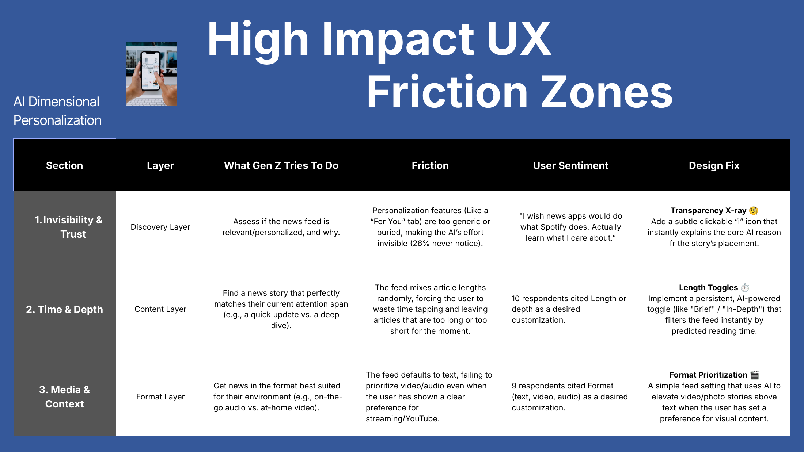
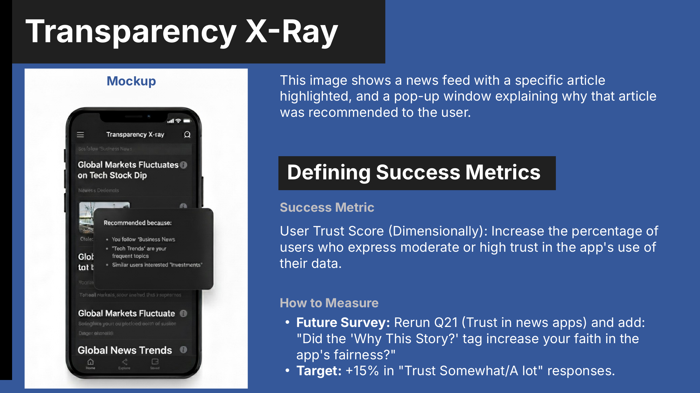
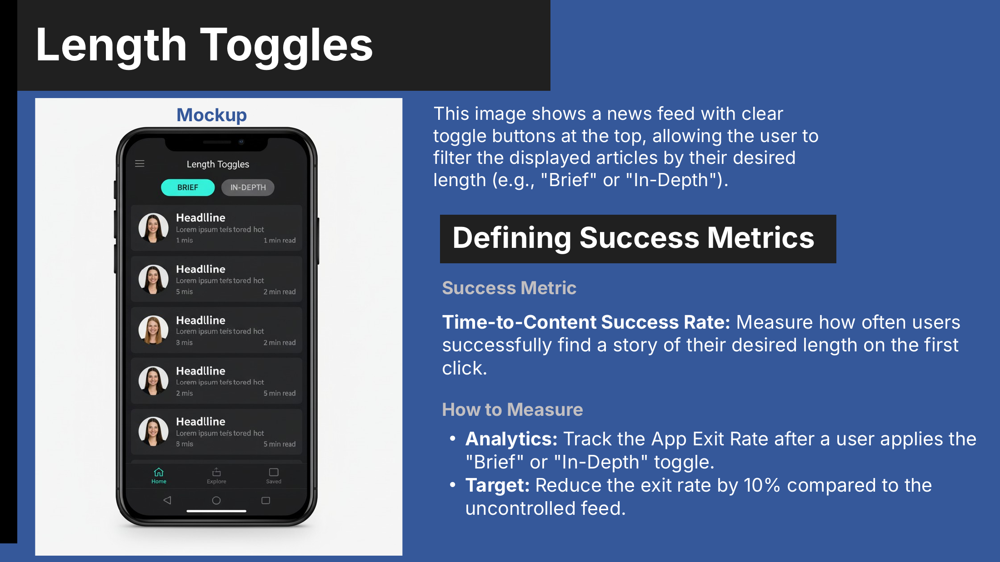
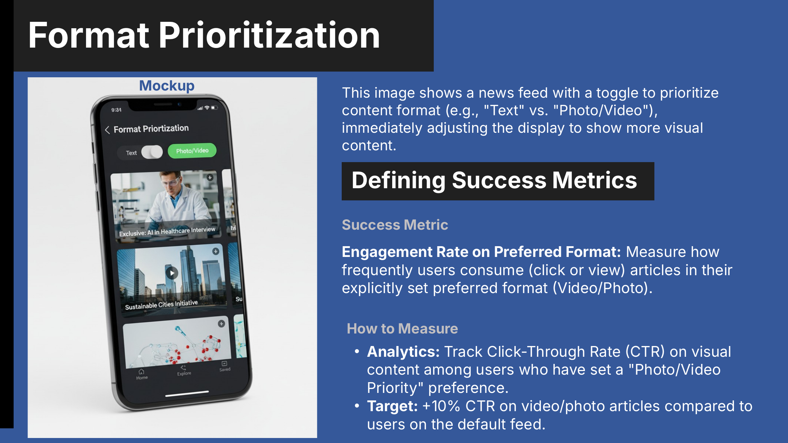

# 📰 AI Personalization for Gen Z News
### Turning a "black box" news feed into a trustworthy co-pilot

**AI Product Strategy · Consumer Insights** · Externship project · Aug 2025 – Oct 2025

---

## Contents
[TL;DR](#tldr) · [The Problem](#the-problem) · [Research](#research) · [What We Learned](#what-we-learned) · [Personas](#personas) · [The Solution](#the-solution-ai-dimensional-personalization) · [Success Metrics](#success-metrics) · [Limitations & Next Steps](#limitations--next-steps) · [My Role](#my-role)

---

## TL;DR

| | |
|---|---|
| **Question** | How might a news product use AI personalization in a way Gen Z actually notices and trusts? |
| **Research** | Survey of Gen Z and young adults (20 responses, 19 eligible), recruited through Reddit, LinkedIn, and Instagram |
| **Insight** | Gen Z doesn't want *less* personalization — they want **control** over it and to know **why** they see a story |
| **Solution** | **AI Dimensional Personalization:** personalize *how* news is delivered (length, format, location), not just *what* topics |
| **Features** | Transparency X-Ray · Length Toggles · Format Prioritization — each with a success metric and target |

---

## The Problem

Gen Z expects Spotify-level personalization. News apps feel generic, and the AI behind them is either invisible or distrusted.

> *"I wish news apps would do what Spotify does — actually learn what I care about."* — survey respondent, age 22

---

## Research

| Phase | What I did |
|---|---|
| **1. Frame** | Studied how TikTok, Netflix, and Spotify personalize, using Jobs To Be Done |
| **2. Design** | Built a Google Forms survey on news habits, AI awareness, trust, and preferred controls |
| **3. Recruit** | Shared it on Reddit, LinkedIn, and Instagram with a [community outreach post](Community%20Outreach%20-%20AI%20Personalization%20%28standard%29.pdf) |
| **4. Analyze** | Compared rival platforms through a KPI lens; coded quantitative patterns and open-ended answers |
| **5. Recommend** | Turned the findings into a hypothesis, three features, and measurable targets |

**Who answered:** mostly 18–24 (68%) and students (74%). Nearly all get news through social media (89%), and their top platforms are YouTube, Instagram, and Netflix.

---

## What We Learned

| Finding | Evidence (of 19 eligible respondents) |
|---|---|
| 🔍 **Personalization is invisible** | About **1 in 4** never notice or use personalized features |
| 🔒 **Trust is low** | **8 of 19 (42%)** have little or no trust in news apps to use their data responsibly |
| 💡 **People want to know why** | **15 of 19 (79%)** say it matters to know why a story was recommended |
| 🎛️ **People want control** | Most want to pick topics themselves or mix manual and automatic, rather than a fully automatic feed |
| ⏱️ **Control means delivery, not just topics** | **10** want to control length or depth; **9** want to control format (text, video, audio) |
| 🫧 **Fear of the filter bubble** | Open answers asked for "less biased" feeds with a mix of viewpoints and the unexpected |

**Core insight:** Personalization is failing because it's a black box. Gen Z wants a **co-pilot** — they set the direction, and AI does the heavy lifting.

---

## Personas

| Persona | Profile | What they want |
|---|---|---|
| **Jerry, the Skeptic** | 22 · Student · US | Less bias and a mix of opinions, not a filter bubble |
| **Alice, the Pragmatist** | 27 · Marketing Director · US | More from the creators she already trusts |
| **Derek, the Critical Thinker** | 22 · Student · US | Full transparency about how his data is used |
| **Janice, the Power User** | 26 · Student · Malaysia | Control over topic, length, format, and tone |

**What they share:** all four reject a passive, generic feed.

---

## The Solution: AI Dimensional Personalization

**Hypothesis:** If the feed adapts to *how, where, and when* people read — length, format, and location — and explains its choices, more users will notice personalization and trust it.

| Friction | Design fix |
|---|---|
| **Invisibility & trust** — users can't tell if or why the feed is personalized | **Transparency X-Ray:** an "i" icon on each story that explains why it was recommended |
| **Time & depth** — the feed mixes quick updates and long reads at random | **Length Toggles:** a "Brief / In-Depth" switch that filters by predicted reading time |
| **Media & context** — the feed defaults to text, even for video-first users | **Format Prioritization:** a setting that moves video and photo stories up for users who prefer them |

| Transparency X-Ray | Length Toggles | Format Prioritization |
|---|---|---|
|  |  |  |

---

## Success Metrics

| Feature | Metric | How to measure | Target |
|---|---|---|---|
| **Transparency X-Ray** | User trust score | Rerun the trust question, and ask whether "Why this story?" changed their view | **+15%** "trust somewhat / a lot" |
| **Length Toggles** | Time-to-content success | App exit rate after using a length toggle | **−10%** exit rate vs. the default feed |
| **Format Prioritization** | Engagement on preferred format | Click-through rate on video and photo for users who chose that format | **+10%** CTR vs. the default feed |
| **Overall** | Visibility | Share of users who "never notice" personalization | Lower than today's ~1 in 4 |

*These are proposed targets for a pilot, not measured results.*

---

## Limitations & Next Steps

- **Small sample.** 19 responses can show direction, but not prove behavior. The next survey should reach 100+ respondents.
- **Convenience sampling.** Recruiting on social media skews toward heavy social users.
- **Next:** prototype the three features, run usability tests, then A/B test against the default feed using the metrics above.

---

## My Role

**Product strategist and researcher**

- **Research:** survey design, recruitment, and analysis of quantitative and open-ended answers
- **Synthesis:** personas, friction mapping, and the core hypothesis
- **Product:** three feature concepts, mockups, success metrics, and the pitch

**Methods:** Jobs To Be Done · survey research · competitive KPI analysis · personas · friction mapping · hypothesis-driven design
**Tools:** Google Forms · PowerPoint · AI-assisted analysis

---

## Files

| File | What it is |
|---|---|
| [News Corp Gen Z Consumer Insight.pptx](News%20Corp%20Gen%20Z%20Consumer%20Insight.pptx) | The full pitch deck with speaker notes |
| [Community Outreach – AI Personalization.pdf](Community%20Outreach%20-%20AI%20Personalization%20%28standard%29.pdf) | The social post used to explain the topic and recruit respondents |
| [`Images/`](Images) | Key slides shown in this README |

**Lashawn Fofung** · Technical Product Manager · [LinkedIn](https://www.linkedin.com/in/lashawnfofung/) · [MBA Portfolio](https://github.com/LashawnFofung/MBA-IT-Management-Portfolio) · [AI Portfolio](https://github.com/LashawnFofung/AI-Portfolio)

